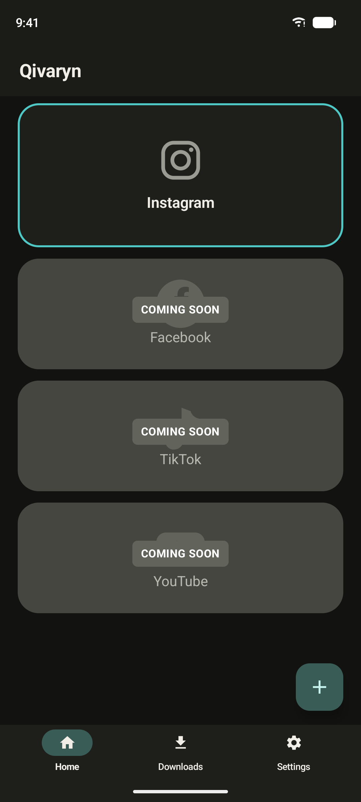
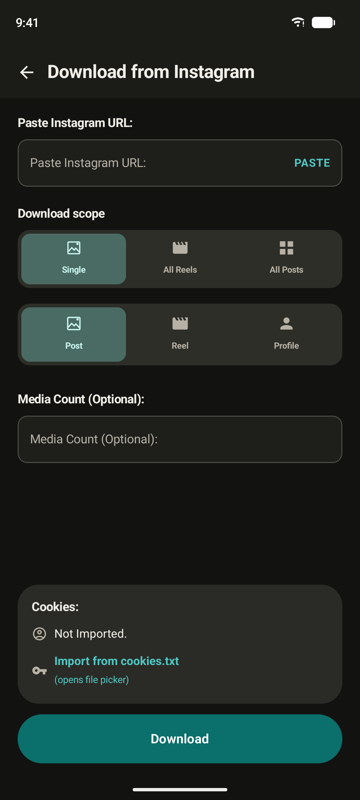
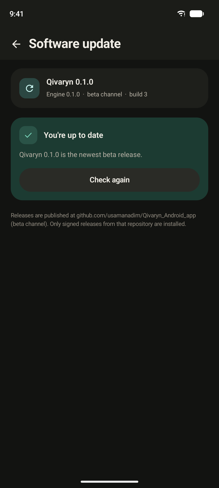
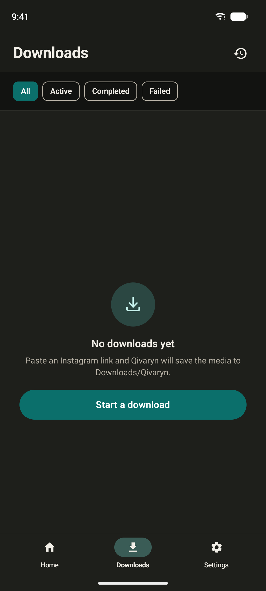
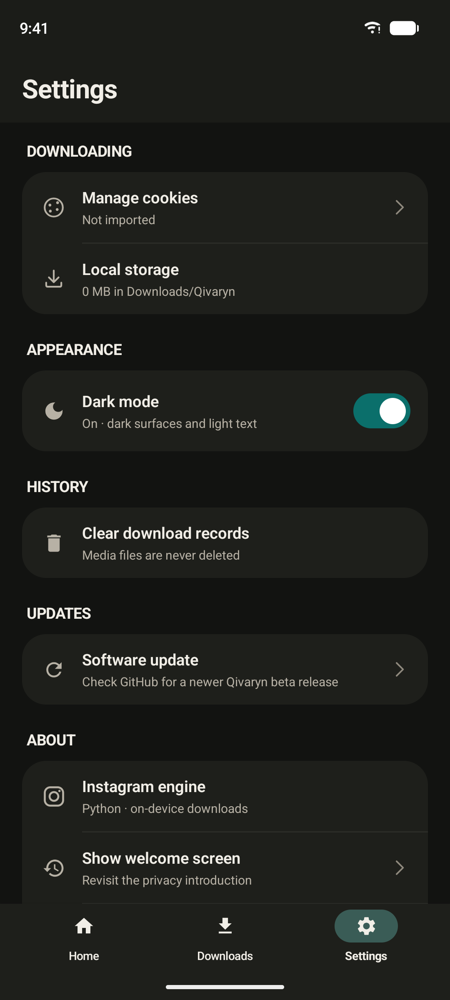

# Qivaryn

Qivaryn is a serverless Instagram media downloader for Android. The UI is Kotlin
and Jetpack Compose; the downloader is the Qivaryn Python engine compiled into
the APK. No server, no ads, no tracking.

[**Download the 0.1.0 beta APK**](https://github.com/usamanadim/Qivaryn_Android_app/releases/download/v0.1.0/Qivaryn-0.1.0-universal.apk)
· [Release notes](docs/release-notes/v0.1.0.md)

## Screenshots

<p align="center">
  
  
  
</p>
<p align="center">
  
  
</p>

## Features

- Single posts, reels, and profiles
- **All Reels** and **All Posts** bulk downloads
- Saves to `Downloads/Qivaryn`, with history, thumbnails, open, and share
- Persisted dark mode
- Built-in updater on the beta channel

## Install

1. Download `Qivaryn-0.1.0-universal.apk` from
   [Releases](https://github.com/usamanadim/Qivaryn_Android_app/releases/tag/v0.1.0).
2. Open the file and allow installing unknown apps if prompted.
3. Requires Android 8.0 or newer (API 26).

This is a pre-1.0 beta. The version stays on the `0.x` line while the app targets
one platform; `1.0.0` is reserved for the feature-complete, all-platforms
release.

## Build

Requires JDK 17, Android SDK 36, and Python 3.11 for Chaquopy.

```powershell
.\gradlew.bat :app:assembleDebug     # debug APK
.\gradlew.bat :app:assembleRelease   # signed release
```

Release builds read signing details from a git-ignored `keystore.properties`:

```properties
storeFile=keystore/qivaryn-release.jks
storePassword=…
keyAlias=qivaryn
keyPassword=…
```

The default update channel is `beta`. Build a stable-only channel with
`-Pqivaryn.updateChannel=stable`.

## Updates

Settings → **Software update** checks GitHub Releases in this repository,
verifies the APK checksum and signature, and installs it through Android's
package installer. Beta builds accept `0.x` pre-releases and stable releases;
stable builds accept stable releases only.

Push a tag that matches `versionName` (for example `v0.1.0`) to publish a
release. The [Release workflow](.github/workflows/release.yml) builds, signs,
checksums, and publishes the APK automatically.

## Links

- [Qivaryn engine](https://github.com/usamanadim/qivaryn-engine)
- [Update mechanism and release checklist](docs/UPDATES.md)
